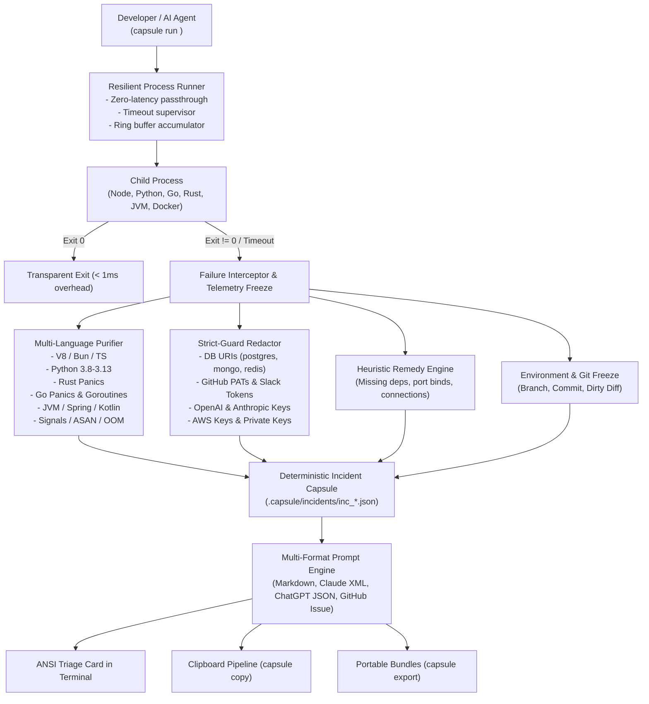

<div align="center">

# 📦 capsule

### The flight recorder for terminal commands. Instant incident capsules for humans & AI.

[](https://github.com/shenald-dev/capsule/actions)
[](https://www.npmjs.com/package/@shenald/capsule)
[](https://github.com/shenald-dev/capsule/releases)
[](LICENSE)
[](package.json)
[](https://github.com/shenald-dev)

<br />

```text
npx @shenald/capsule run npm test
```

*Never copy-paste 400 lines of terminal error vomit into ChatGPT or Claude again.*

</div>

---

## ⚡ The Problem vs. The Capsule Solution

```text
THE OLD WAY (400 Lines of Noise):
$ npm run build
... 380 lines of webpack, babel, and express node_modules scroll off screen ...
TypeError: Cannot read properties of undefined (reading 'sub')
    at validateSession (/app/node_modules/next/dist/server/base-server.js:412:18)
    at ... 40 internal stack frames ...
(Developer scrolls frantically, copies messy text, pastes into Claude, gets hallucinated response)

THE CAPSULE WAY (Instant Triage & Ground Truth):
$ capsule run npm run build

════════════════════════════════════════════════════════════════════
 💥 COMMAND FAILED  │  npm run build
 Status: Exit 1  │  ⏱️ 1.42s  │  inc_20261106_001632_iuie  │  git:main*
────────────────────────────────────────────────────────────────────
 📍 Root Cause: TypeError: Cannot read properties of undefined (reading 'sub')
   Location: src/auth/session.ts:42:18

 ✨ Diagnostic Hint: [MISSING_DEPENDENCY] Potential null dereference on session object
   Check if session and session.user are defined before property lookup.

   ────────────────────────────────────────────────────────────
      40 | export function validateSession(session: Session) {
      41 |   // Missing nil-check on session object
    > 42 |   return session.user.sub;
      43 | }
   ────────────────────────────────────────────────────────────

 > Quick Actions: capsule copy (AI prompt) │ capsule replay (rerun) │ capsule explain │ capsule last --json
════════════════════════════════════════════════════════════════════
```

---

## ✨ Features

- 🧹 **Multi-Language AST & Stacktrace Purifier:** Strips framework noise, `node_modules/`, `site-packages/`, and runtime internals across **Node.js/V8/Bun/Deno, Python (3.8-3.13), Rust panics (legacy & modern Rust 1.70+), Golang panics & goroutines, and JVM (Java/Kotlin/Scala/Spring)**.
- 🔍 **Compiler Error Diagnostic Engine:** Full diagnostic extraction for **TypeScript (`tsc`), Rustc (`cargo build`), GCC/Clang, and Javac** errors with highlighted source code previews.
- 💡 **Heuristic Remedy Diagnostic Engine:** Instantly recognizes common issues (`MISSING_DEPENDENCY`, `PORT_CONFLICT`, `CONNECTION_REFUSED`, `PERMISSION_DENIED`, `MEMORY_EXHAUSTION`, `SEGMENTATION_FAULT`, `COMMAND_NOT_FOUND`, `EXECUTION_TIMEOUT`, `DATABASE_MIGRATION`) and surfaces targeted action commands directly in your terminal triage card.
- 🤖 **Multi-Format Zero-Hallucination AI Bundles:** Export incident capsules in 4 tailored formats:
  - **Clean Markdown** (Default for Claude, ChatGPT, Cursor, and human review)
  - **Anthropic Claude XML** (`--format claude`) with structured artifact blocks and purified call chains
  - **OpenAI ChatGPT JSON** (`--format chatgpt`) system/user prompt ready for API calls
  - **GitHub Issue Template** (`--format github`) with collapsible `<details>` blocks for error logs, diffs, and stacktraces
- 🛡️ **Strict-Guard Secret Redaction:** Automatically masks database passwords (`postgres://`, `mongodb://`, `redis://` with or without usernames), GitHub PATs (`ghp_`, `github_pat_`), OpenAI/Anthropic/Gemini keys (`sk-`, `sk-ant-`, `AIzaSy`), AWS access keys (`AKIA`), Slack tokens, JWTs, Bearer headers, JSON/YAML key-values (`"password": "..."`), and RSA/OpenSSH private keys in environment snapshots and terminal outputs.
- 🔄 **Deterministic Replay & CWD Preservation:** Test bug fixes instantly with `capsule replay`—preserves the original working directory and compares previous exit codes and runtimes against the current execution to verify resolution.
- ⏱️ **Process Execution Timeouts:** Prevent runaway test suites and infinite loops with `-t, --timeout <ms>`. Gracefully terminates child process trees on Windows (`taskkill /T /F`) and POSIX signals, eliminating orphan worker processes and classifying timeout exit code 124.
- 📦 **Standalone Incident Bundles:** Export (`capsule export`) and share portable JSON incident bundles with teammates or attach them to bug reports; import (`capsule import`) and replay on any machine.
- 🔍 **Incident Search & Partial ID Matching:** Query recorded incidents by keyword, exit code, or failure status (`capsule list --search "auth" --status failed`), and inspect or replay incidents using short prefix hashes (e.g. `capsule explain y3sx`).
- 🩺 **Built-In System Doctor:** Self-healing diagnostic suite checking Node.js health, toolchains (Python, Go, Rust, Java), Git integration, storage health, and clipboard mechanics (`capsule doctor`).
- ⚡ **Zero Measurable Overhead:** Streaming passthrough tested at `< 1ms` overhead with >7,300 stacktraces/sec purifier throughput and >160 MB/sec redaction speed.

---

## 📊 Feature Comparison Matrix

| Capability | Raw Terminal | `sentry-cli` | `asciinema` | `Paper` | **Capsule (v0.2.0)** |
|---|:---:|:---:|:---:|:---:|:---:|
| **Zero-Cloud / 100% Local-First** | ✅ | ❌ (Cloud) | ✅ | ✅ | **✅ (100% Local)** |
| **Noise Filtering (`node_modules`)** | ❌ | ❌ | ❌ | ❌ | **✅ (Multi-Language AST)** |
| **Multi-Language Support** | ❌ | ⚠️ (SDK required) | ❌ | ❌ | **✅ (Node, Py, Rust, Go, JVM)** |
| **Heuristic Remedy Hints** | ❌ | ❌ | ❌ | ❌ | **✅ (Automated suggestions)** |
| **Automatic Secret Redaction** | ❌ | ❌ | ❌ | ❌ | **✅ (Strict-Guard Engine)** |
| **Git Dirty Diff & Commit Snapshots** | ❌ | ⚠️ (Commit only) | ❌ | ❌ | **✅ (Diff + Branch + State)** |
| **Deterministic Issue Replay** | ❌ | ❌ | ❌ | ❌ | **✅ (`capsule replay`)** |
| **1-Click AI Prompt Formats** | ❌ | ❌ | ❌ | ⚠️ (Manual file) | **✅ (MD, Claude, GPT, GH)** |
| **Execution Timeouts** | ❌ | ❌ | ❌ | ❌ | **✅ (`--timeout`)** |
| **Shareable Offline Bundles** | ❌ | ❌ | ❌ | ❌ | **✅ (`export` / `import`)** |
| **Streaming Overhead** | 0ms | >250ms | ~20ms | ~50ms | **< 1ms** |

---

## 🚀 Quickstart

Run any command instantly under the flight recorder without installing anything:

```bash
# Execute via npx
npx @shenald/capsule run npm test

# Or install globally for everyday shell use
npm install -g @shenald/capsule
# (or pnpm add -g @shenald/capsule)
```

Now use `capsule` (or the short alias `c`) in front of any command:

```bash
# Run tests
capsule pytest

# Run builds with timeout
capsule npm run build --timeout 30000

# Run Go or Rust tests
capsule go test ./...
capsule cargo test
```

---

## 💻 CLI Commands & Usage

### 1. `capsule run <command...>` (or `capsule <command...>`)
Wraps any build, test, script, or compiler. If it succeeds, it's transparent. If it crashes, it generates an instant incident card.
```bash
capsule run npm test
capsule run cargo test
capsule run pytest tests/
capsule run go test ./...
```

Options:
- `-c, --copy`: Automatically copy the AI prompt to your clipboard on failure.
- `-t, --timeout <ms>`: Kill long-running or hanging commands after specified milliseconds.
- `-f, --format <format>`: AI prompt format: `markdown` (default), `claude`, `chatgpt`, or `github`.
- `-q, --quiet`: Suppress the execution timing summary on success.
- `-s, --silent`: Suppress child process stdout/stderr stream.
- `--json`: Output the entire incident capsule as machine-readable JSON.

### 2. `capsule copy [id]`
Copies the AI-ready prompt for the latest (or specified) incident to your clipboard in your preferred format.
```bash
capsule copy
capsule copy --format claude     # Copy Claude XML artifact format
capsule copy --format github     # Copy GitHub Issue template
```

### 3. `capsule explain [id]`
Displays deep diagnostic insights, root-cause locations, heuristic remedies, and recent uncommitted git diffs side-by-side:
```bash
capsule explain
```

### 4. `capsule replay [id]`
Re-runs the exact command from the incident capsule and compares previous exit codes against the current run to verify resolution.
```bash
capsule replay
# Output: ✨ ISSUE RESOLVED! │ Previous: Exit 1 ➔ Current: Exit 0 (48ms faster)
```

### 5. `capsule export [id]` & `capsule import <file>`
Share offline incident bundles across team machines or attach to issue trackers:
```bash
capsule export -o my-bug.bundle.json
capsule import my-bug.bundle.json
```

### 6. `capsule last`
Displays the latest incident in terminal card, markdown, or JSON format:
```bash
capsule last               # Renders ANSI triage card
capsule last --format claude # Outputs Anthropic XML prompt
capsule last --markdown    # Outputs standard Markdown prompt
capsule last --json        # Outputs raw telemetry JSON
capsule last --raw         # Outputs the original raw unpurified terminal log
```

### 7. `capsule list`
Lists and searches recent recorded incidents in `.capsule/incidents/`:
```bash
capsule list --limit 5
capsule list --search "TypeError"
capsule list --status failed
capsule list --exit-code 1
```

### 8. `capsule clean`
Prunes incident capsules to keep your disk clean:
```bash
capsule clean --keep 5     # Keep only the last 5 incidents
capsule clean --all        # Wipe all recorded incidents
```

### 9. `capsule doctor`
Runs comprehensive diagnostic health checks across your environment:
```bash
capsule doctor
```

---

## 🏗️ System Architecture (v0.2.0)



---

## ⚡ Empirical Performance Benchmarks

Capsule is engineered to add zero perceptible overhead to builds and test suites. Benchmarked on Node.js v22 on an AMD Ryzen 5 / 12 CPU host:

| Benchmark Dimension | Measured Result | Significance |
|---|---|---|
| **Process Runner Overhead** | **0.00 ms** (imperceptible) | Invisible passthrough on all terminal commands |
| **Stacktrace Purifier Throughput** | **7,348 ops/sec** | Instant sub-millisecond AST extraction across 5 runtimes |
| **Secret Redaction Throughput** | **165.75 MB/sec** | Zero memory spikes even with massive log dumps |
| **Markdown Prompt Generation** | **428,679 prompts/sec** | 0.002 ms per formatted AI prompt |
| **Claude XML Prompt Generation** | **781,128 prompts/sec** | 0.001 ms per Claude XML artifact |
| **GitHub Issue Prompt Generation** | **475,003 prompts/sec** | 0.002 ms per GitHub Issue template |

*Run the benchmark suite on your own machine anytime with `pnpm run bench`.*

---

## 🛡️ Security & Secret Redaction Guarantee

Capsule is engineered with a **zero-leakage security boundary**. When capturing system snapshots:
- Database connection strings (`postgres://`, `mongodb://`, `redis://`, etc.) have their passwords automatically replaced with `[REDACTED]`.
- All environment variables matching `*KEY*`, `*SECRET*`, `*TOKEN*`, `*AUTH*`, `*PASS*`, `*PWD*`, `*CREDENTIAL*`, `*PRIVATE*`, `*CERT*`, `*AWS*`, `*STRIPE*`, `*DATABASE_URL*` are masked with `[REDACTED]`.
- Vendor credentials (GitHub PATs, OpenAI API keys, Anthropic API keys, AWS Access Key IDs, Slack bot tokens, JWTs, Bearer headers, and RSA/OpenSSH private keys) are automatically stripped from raw stdout/stderr logs.
- Incident capsules are saved strictly on your local disk in `.capsule/incidents/`. Capsule never transmits telemetry over the network.

---

## 🤝 Contributing

We welcome contributions! Please read our [Contributing Guide](CONTRIBUTING.md) to get started with building, testing, and submitting pull requests.

---

## 📄 License

Capsule is open-source software licensed under the [MIT License](LICENSE).  
Authored with craft by **[Shenald Fernando (shenald-dev)](https://github.com/shenald-dev)**.
